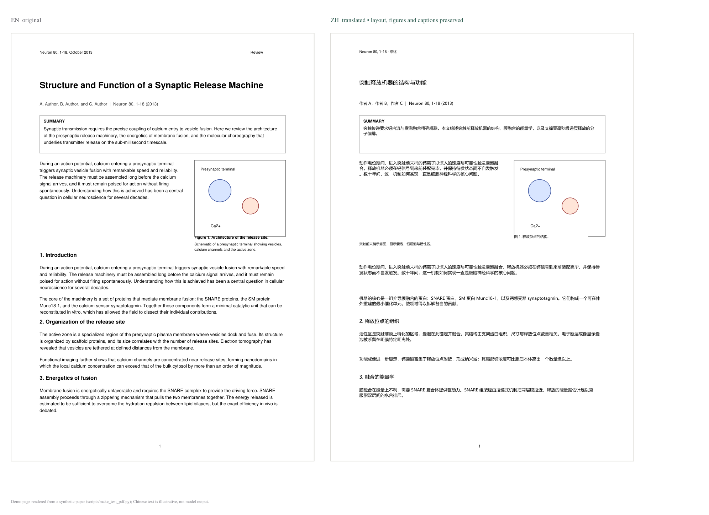

# 神经生物学学习

> 每天一篇神经科学论文：**保留原版排版与插图的中文对照译文**、**结构化解读**、**随时可问的对话**。

**在线版（免安装、打开即用）**：<https://qingaorui.github.io/neuro-learning/>



*左：原始论文页　右：程序生成的译文页——双栏、插图、表格线、图注位置全部保留，只把文字换成中文。演示页由 `scripts/make_test_pdf.py` 生成的合成论文渲染，中文为示意，非模型输出。*

---

## 两种形态

| | 在线版 | 本地版 |
|---|---|---|
| 地址 | GitHub Pages，打开网页即用 | 本机 `127.0.0.1:8765` |
| 运行方式 | 纯前端，浏览器里跑 | Python 服务 + 浏览器 |
| 需要安装 | 无 | Python 3.9+ 与 PyMuPDF |
| 数据存放 | 你自己的浏览器（IndexedDB） | 本机 `data/artifacts/` |
| API Key | 存在你自己浏览器 | 存在 `app/config.json` |
| 逐页对照译文 | ✅ canvas 叠字 | ✅ PDF 重写 |
| 导出 | 保存单页 PNG | 下载整份译文 PDF |
| 自动抓 OA 版 PDF | ❌ 浏览器端受跨域限制 | ⚠️ 尽力而为，基本拿不到 |
| 全文（JATS）翻译 | ✅ 直连 PubMed | ✅ |

在线版的所有请求（大模型、PubMed）都由**你的浏览器直接发出**，不经过任何中间服务器，Key 也不会离开你的机器。

## 这是什么

两样东西合在一起：

| | 内容 |
|---|---|
| **文献库** | 98 篇神经生物学英文文献，全部来自 PubMed 可核查，按 14 条主线 + 难度梯度排成 98 天 |
| **程序** | 推送今日论文、生成逐页对照译文、生成解读、随时提问 |

## 功能

- **今日推送** —— 打开即今日该学的一篇；本地版可配 Windows 计划任务定时自动打开。
- **逐页对照译文** —— 拖入 PDF，按原文 bbox 重排中文，字号自动缩放，插图与版式原样不动；可切原文/译文、翻页、缩放、导出。
- **详细解读** —— 一句话结论、要回答的问题、前置知识、方法拆解、关键结果与证据、图表逐张读法、局限与争议、课程定位、术语表、自测题。
- **随时提问** —— 右侧对话抽屉，自动锚定当前论文的正文与图表，流式回答，按论文分别保存历史。
- **进度追踪** —— 已读标记、模块完成度、连续天数。
- **降级可用** —— 没有 API Key 也能跑通全流程，译文处显示明确占位提示，不会假装成功。

## 在线版使用

1. 打开 <https://qingaorui.github.io/neuro-learning/>
2. 点「设置」，填入模型接口与 API Key（默认 DeepSeek：`https://api.deepseek.com` / `deepseek-chat`）
3. 把论文 PDF 拖进卡片，等进度跑完
4. 在「译文」读对照，在「图文解读」看分析，有疑问点右下角「💬 提问」

Key 存在浏览器 `localStorage`，换浏览器或清缓存后需要重新填。

## 本地版使用

```powershell
pip install pymupdf
.\启动神经生物学学习.bat            # 双击也可以
```

默认监听 `http://127.0.0.1:8765`，只对本机开放。

- 创建桌面快捷方式：`powershell -ExecutionPolicy Bypass -File .\创建桌面快捷方式.ps1`
- 每日定时推送：`powershell -ExecutionPolicy Bypass -File .\设置每日提醒.ps1 -Time 08:30`

## 配置大模型

任何 **OpenAI 兼容**接口都能用，改地址与模型名即可：

| 字段 | DeepSeek 填法 |
|---|---|
| 接口地址 | `https://api.deepseek.com` |
| 模型名称 | `deepseek-chat` |
| API Key | `sk-` 开头 |

## 文献库

98 篇：**综述 40 · 原始研究 49 · 历史原典 9**；入门 19 · 进阶 53 · 挑战 26；跨 1949–2023 年。

| 主线 | 篇数 | 主线 | 篇数 |
|---|---|---|---|
| M01 神经元与电信号 | 6 | M08 睡眠与昼夜节律 | 7 |
| M02 突触传递 | 7 | M09 神经调质与奖赏 | 7 |
| M03 神经发育与解剖 | 6 | M10 胶质、血管与神经免疫 | 7 |
| M04 感觉系统 | 7 | M11 神经疾病 | 8 |
| M05 运动系统 | 6 | M12 方法与前沿 | 8 |
| M06 学习与记忆 | 7 | M13 认知、注意与意识 | 6 |
| M07 情绪与应激 | 7 | M00 历史原典 | 9 |

完整目录见 [`index.md`](index.md)，结构化数据见 [`data/papers.json`](data/papers.json)。

### 为什么这样选

面向**有分子/细胞/遗传学背景、但缺神经科学系统训练**的读者：

- 不重复讲膜电位、离子通道、受体信号转导这类基础
- 原始研究占一半，用来练读方法与图
- **综述按标题字段检索**：标题就叫 *The action potential in mammalian central neurons* 的综述几乎必然是概念级的；而全文检索会把心脏电生理里的 "ion channel" 一起捞进来
- **原始论文按被引次数排序**（Europe PMC `sort=CITED`），每模块同时取「全时段高被引」与「近年高被引」

## 目录结构

```
.
├─ docs/                        在线版（GitHub Pages 根目录）
│  ├─ index.html · app.js · style.css
│  ├─ data/papers.json          语料副本
│  └─ vendor/pdf.js             pdf.js（本地化，不依赖 CDN）
├─ app/                         本地版
│  ├─ server.py                 HTTP 服务 + REST API
│  ├─ core/                     config / corpus / sources / pdfdoc / llm / jobs / store
│  └─ static/
├─ 启动神经生物学学习.bat        本地版一键启动
├─ 创建桌面快捷方式.ps1
├─ 设置每日提醒.ps1
├─ index.md                     课程目录（人读）
├─ data/papers.json             语料库（98 篇）
├─ tools/                       pubmed.py / europepmc.py
└─ scripts/                     语料采集、测试 PDF 生成、无头浏览器验收
```

## 本地版 API

前端只是这套接口的第一个消费者。

| 方法 | 路径 | 作用 |
|---|---|---|
| GET | `/api/state` | 今日论文、配置、统计、任务状态 |
| GET | `/api/modules` · `/api/plan` | 课程模块 / 全部篇目 |
| GET | `/api/paper/{D007 或 7}` | 单篇详情 |
| GET | `/api/paper/{id}/fulltext` | 全文（JATS 解析后） |
| GET | `/api/paper/{id}/translation` | 译文（`mode` = `pdf`/`text`/`none`） |
| GET | `/api/paper/{id}/interpretation` | 解读 JSON |
| GET | `/api/paper/{id}/page/{n}.png?mode=translated` | 页面图 |
| GET | `/api/pdf/{id}/translated.pdf` | 下载译文 PDF |
| GET/POST | `/api/paper/{id}/chat` | 对话历史 / 提问（SSE 流式） |
| POST | `/api/paper/{id}/prepare` | 抓全文 → 翻译 → 重排 → 解读 |
| POST | `/api/paper/{id}/pdf` | 上传 PDF |
| POST | `/api/paper/{id}/read` | 标记已读 |
| GET/POST | `/api/config` | 读写配置（Key 只回显掩码） |

## 已知限制

1. **自动下载 PDF 基本不可用**。语料以综述期刊为主，开放获取比例低；PMC 的 PDF 与图片直链均已被网关拦截（实测 PMC 直链、OA 服务、Europe PMC、Unpaywall 全部失败，OpenAlex 取到的唯一链接被 403）。**拖入 PDF 是可靠路径。**
2. **扫描版 PDF 无法处理**。无文本层时明确报错，不假装成功。
3. **中文可能挤**。译文按原 bbox 排版、字号自动缩到 6.5pt 为止；图表密集或小字号论文中个别块仍可能显示不全。
4. **图内短标签**（坐标轴、图例、子图编号）不到 8 字符不翻译，否则中文会把插图挤坏；图注与表注仍然翻译。
5. **1975 年前的 5 篇原典没有摘要**，这是 PubMed 的历史通例，数据里用 `abstract_note` 标注。
6. **质量取决于所配模型**，关键结论请回原文核对。
7. **在线版不收 PDF**：浏览器无法绕过跨域去抓出版社 PDF，只能由你上传。

## 实现细节

技术选型刻意保守：线上版零依赖（pdf.js 已本地化，不用 CDN）、无构建步骤；本地版除 PyMuPDF 外全用标准库。

踩过的坑记录在此：

1. **PubMed 不接受 `"短语"[ti]`** —— 带引号再跟字段标签返回 0 条，去掉引号才有效。
2. **shell 的 TLS 可能用不了** —— 沙箱下 `schannel` 取不到证书，`curl` / `Invoke-WebRequest` 访问 https 全失败，而 Python 走 OpenSSL 正常。
3. **同形词污染** —— `TITLE:"dendritic"` 会把免疫学的树突状细胞全捞进来，且因引用量更高而霸占前排。
4. **PowerShell 5.1 按 GBK 读无 BOM 的 `.ps1`** —— 中文字符串会被截成语法错误。`.ps1` 必须 UTF-8 **带 BOM**；`.bat` 则绝不能带 BOM。
5. **PyMuPDF 不做字体子集化** —— 中文字体整包嵌入，两页文档能涨到 12 MB；加 `doc.subset_fonts()` 后降到 80 KB。
6. **IndexedDB 封装别把请求对象当结果** —— `out?.result ?? out` 在键不存在时会回退成 `IDBRequest`（truthy），后续当 Blob 用直接崩。
7. **同一个 canvas 不能并发 render** —— pdf.js 抛 `Cannot use the same canvas during multiple render() operations`；改成串行队列 + 过期请求跳过。
8. **同一基线的左右两栏会被并成一块** —— 左栏正文与右侧图内标签合并后，白色遮盖区会横跨两栏把插图吃掉；必须先按水平间距切段再聚块。

## 开发与测试

```powershell
npm install                                  # 仅开发需要
npx playwright install chromium
npm run serve                                # 启动 docs/ 静态站（8899）
npm run e2e                                  # 无头浏览器跑完整流程
```

`scripts/e2e_test.mjs` 会拦截模型接口、注入假译文，真实走完「加载 → 上传 PDF → 翻译 → canvas 叠字 → 解读 → 对话 → 标记已读」，任一步失败即退出非零。
`scripts/canvas_dump.mjs` 直接把画布导出成 PNG，用于肉眼检查排版。

## 重新生成语料库

```powershell
python scripts\collect_candidates.py   # 综述候选池
python scripts\collect_primary.py      # 原始论文候选池
python scripts\build_corpus.py         # 校验 + 生成 papers.json / index.md
```

换文：改 `scripts/build_corpus.py` 中对应模块的 `(PMID, 类型, 难度, 导读)` 一行，重跑第三步。脚本会校验 PMID 真实存在、是英文、有摘要、无重复。

## 说明

个人学习工具，文献版权归原作者与出版方所有；程序只做本地个人阅读辅助，请勿分发译文。
仓库暂未附 License。
